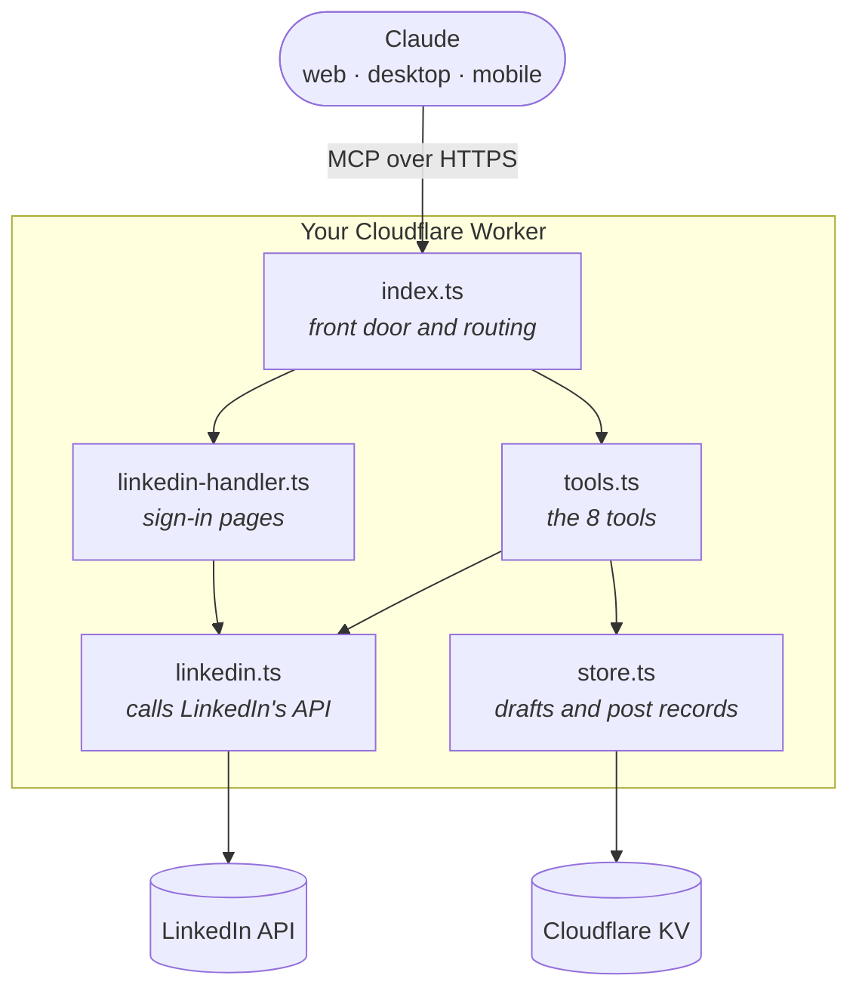
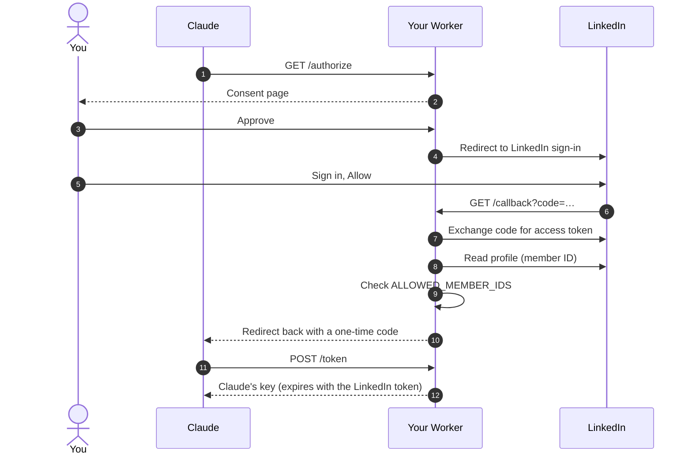
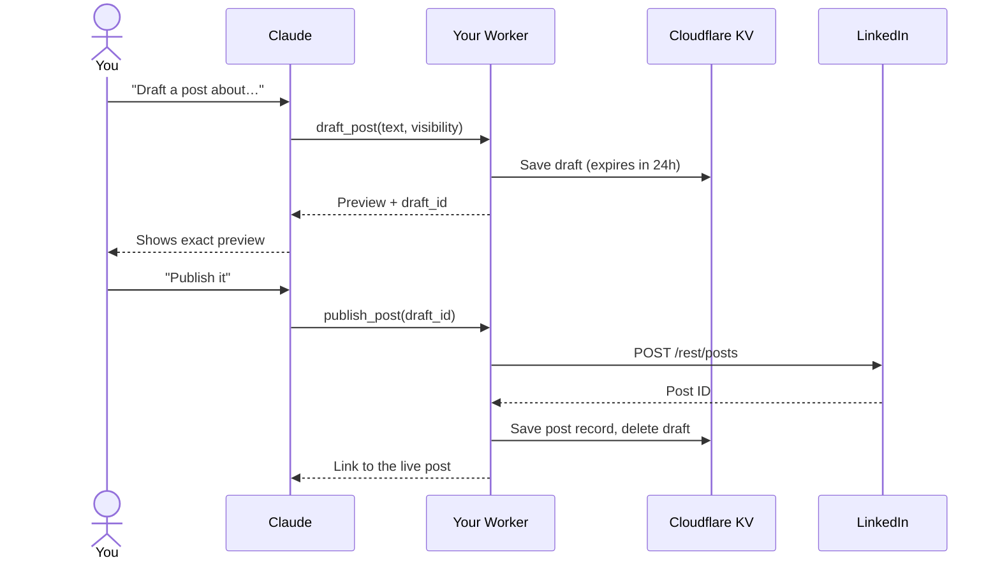
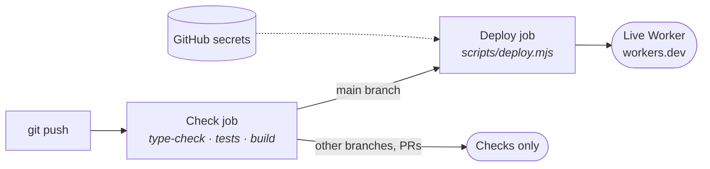

# postline-mcp

[](https://github.com/arooj1/postline-mcp/actions/workflows/ci.yml) [](LICENSE)

An open-source MCP connector that lets Claude draft, publish, edit and delete posts on **your own** LinkedIn profile — using only LinkedIn's official API.

> **Status:** v0.1 — deployed and working as a Claude custom connector. **All 8 tools verified live through Claude on Nov 14, 2026** (see [test results](docs/phase-0-results.md)).
>
> Not affiliated with, endorsed by, or sponsored by LinkedIn Corporation. LinkedIn is a trademark of LinkedIn Corporation.

## Why this exists

Several LinkedIn MCP servers already exist. Some drive your logged-in browser session or use your password, which breaks LinkedIn's User Agreement and can get your account restricted. Others only run locally in Claude Desktop.

postline-mcp is built on three rules:

1. **Official API only.** No scraping, no browser automation, no stored passwords.
2. **Honest scope.** The table below states exactly what LinkedIn allows. If LinkedIn doesn't allow it, this tool doesn't pretend to do it.
3. **Nothing publishes without your OK.** Claude drafts, you preview, you confirm.

## What it can and can't do

| Capability | Status | Why |
|---|---|---|
| Publish a post (text, link card, or one image) to your profile | ✅ Verified live | Self-serve `w_member_social` permission |
| Comment on / react to a post (by link) | ✅ Verified live | Same permission, via LinkedIn's `/v2` endpoints (the newer `/rest` ones are partner-only for these) |
| Delete your own post | ✅ Verified | Same permission |
| Edit your own post's text (in place, keeps likes and comments) | ✅ Verified | Same permission; `PARTIAL_UPDATE` on `/rest/posts` |
| List posts you made **through this tool** | ✅ Built | Kept in the connector's own per-user record |
| Import your post history | ✅ Planned | From LinkedIn's "Download your data" export |
| Read your feed, others' posts, comments, analytics | ❌ Not possible | `r_member_social` is closed by LinkedIn |
| Post as a Company Page | ❌ Not in v1 | Requires LinkedIn partner approval |
| Read your data via the DMA Portability API | ❌ EU/EEA/Swiss members only | LinkedIn restricts it by profile location |

## How it works

Three parties: Claude, **your own** Cloudflare Worker (this code), and LinkedIn. Claude never sees your LinkedIn token; it only holds a key to your Worker.



Each file has one job, which keeps changes and failures local:

- **`linkedin.ts`** is the only file that talks to LinkedIn. When LinkedIn changes its API, this is the only file to fix.
- **`tools.ts`** has no Cloudflare dependencies, so all of it can be unit-tested with a fake LinkedIn.
- **`store.ts`** hides how data is stored. Every key starts with your LinkedIn member ID.
- **`linkedin-handler.ts`** holds the sign-in pages. Setup mistakes surface here, separately from tool errors.

### Sign-in (once, then about every 60 days)

The Worker does OAuth twice. It is a **client** to LinkedIn, getting your token, and a **server** to Claude, issuing Claude its own key.



### Publishing a post (two turns, on purpose)

Claude can't publish in one step. `draft_post` changes nothing on LinkedIn. `publish_post` needs the `draft_id`, so Claude has to show you the preview first.



## Tools

| Tool | What it does | Changes LinkedIn? |
|---|---|---|
| `get_me` | Which account is connected and when the sign-in expires | No |
| `draft_post` | Prepares a post and returns an exact preview and a `draft_id` | No |
| `publish_post` | Publishes a draft, only after you approve the preview | Yes |
| `edit_post` | Replaces a post's text in place (likes and comments kept) | Yes |
| `delete_post` | Deletes one of your posts | Yes |
| `list_my_posts` | Lists posts published or edited through postline | No |
| `comment_on_post` | Comments on a post as you | Yes |
| `react_to_post` | Like, celebrate, support, love, insightful or funny | Yes |

Text is escaped for LinkedIn's formatting rules, so brackets, asterisks and underscores publish exactly as written, and `#hashtags` become real hashtags.

## Deploy your own (free)

You need:
- A free **Cloudflare** account.
- A **LinkedIn developer app** with **Share on LinkedIn** and **Sign In with LinkedIn using OpenID Connect** added (see [Phase 0 results](docs/phase-0-results.md)).
- A **GitHub** fork of this repo (Option A) or Node 20+ on your machine (Option B).

Your Worker's address will be `https://postline-mcp.<your-subdomain>.workers.dev`. Find your subdomain in the Cloudflare dashboard under **Workers & Pages** (if you've never opened that page, opening it once creates the subdomain).

### Option A — GitHub Actions (recommended)

Every push runs the checks. Pushes to `main` deploy automatically. Nothing needs installing on your machine, and you never run `wrangler login`.



1. **Cloudflare API token.** Go to dash.cloudflare.com → My Profile → **API Tokens** → Create Token → **Edit Cloudflare Workers** template → choose your account → Create. Also copy your **Account ID** from the Workers & Pages page.
2. **LinkedIn redirect URL.** In your LinkedIn app → **Auth** → *Authorized redirect URLs*, add `https://postline-mcp.<your-subdomain>.workers.dev/callback`.
3. **GitHub settings.** In your fork → **Settings → Secrets and variables → Actions**:

   | Type | Name | Value |
   |---|---|---|
   | Variable | `MCP_RESOURCE` | `https://postline-mcp.<your-subdomain>.workers.dev/mcp` |
   | Secret | `CLOUDFLARE_API_TOKEN` | token from step 1 |
   | Secret | `CLOUDFLARE_ACCOUNT_ID` | account ID from step 1 |
   | Secret | `LINKEDIN_CLIENT_ID` | LinkedIn app → Auth tab |
   | Secret | `LINKEDIN_CLIENT_SECRET` | LinkedIn app → Auth tab |
   | Secret | `COOKIE_ENCRYPTION_KEY` | any long random string, e.g. `openssl rand -hex 32` |
   | Secret | `ALLOWED_MEMBER_IDS` | added in step 5 |

   Deploys only run once `MCP_RESOURCE` is set, so forks never deploy by accident.
4. **Deploy.** Actions tab → **CI** → *Run workflow* (or push to `main`).
5. **Connect Claude and allow yourself.**
   1. In Claude, go to Settings → Connectors → **Add custom connector** and paste your `/mcp` URL.
   2. The first sign-in stops on a **"Not allowed"** page showing your LinkedIn member ID. This is expected.
   3. Add that ID as the `ALLOWED_MEMBER_IDS` secret, re-run the workflow, and connect again.

### Option B — From your machine

```bash
git clone https://github.com/arooj1/postline-mcp && cd postline-mcp
npm install
export CLOUDFLARE_API_TOKEN=…  CLOUDFLARE_ACCOUNT_ID=…        # or: npx wrangler login
export MCP_RESOURCE=https://postline-mcp.<your-subdomain>.workers.dev/mcp
export LINKEDIN_CLIENT_ID=…  LINKEDIN_CLIENT_SECRET=…  COOKIE_ENCRYPTION_KEY=$(openssl rand -hex 32)
export ALLOWED_MEMBER_IDS=…                                    # after the first sign-in shows it
node scripts/deploy.mjs
```

Then add the `/callback` URL in LinkedIn and connect Claude as in Option A, steps 2 and 5.

> **Safari users:** `npx wrangler login` can fail because Safari's HTTPS-Only mode blocks the `http://localhost` hand-off. Use an API token (above) instead.

LinkedIn sign-ins last about 60 days. When yours expires, Claude asks you to reconnect.

## Develop

```bash
cp .env.example .dev.vars   # then set LINKEDIN_CLIENT_ID, LINKEDIN_CLIENT_SECRET, COOKIE_ENCRYPTION_KEY
npm run dev                 # http://localhost:8788 (add http://localhost:8788/callback to your LinkedIn app)
npm run check               # type-check + unit tests (CI runs the same)
```

See [docs/ARCHITECTURE.md](docs/ARCHITECTURE.md) for how the code fits together and how to debug it.

`spike/linkedin-spike.mjs` is the standalone script used to verify the API (see [Phase 0 results](docs/phase-0-results.md)).

## Roadmap

- [x] **Phase 0** — Verify publish / edit / delete against the live API — all passed
- [x] **Phase 1** — Core tools with draft → confirm flow, per-user storage, 35 unit tests
- [x] **Phase 2** — Remote MCP connector on Cloudflare Workers with LinkedIn OAuth and owner allowlist
- [x] **Live deployment** — Connected in Claude; text publish, edit, delete and listing verified live (Nov 14, 2026)
- [x] **Remaining live checks** — link card, image, comment and reaction verified (Nov 14, 2026)
- [x] **CI/CD** — GitHub Actions: checks on every push, automatic deploy from `main`
- [ ] **Phase 3** — Import history from LinkedIn's data export, v1.0 release

## License

[MIT](LICENSE) © 2026 Arooj Qureshi
